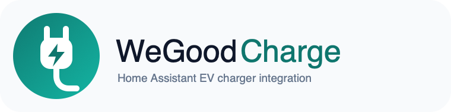
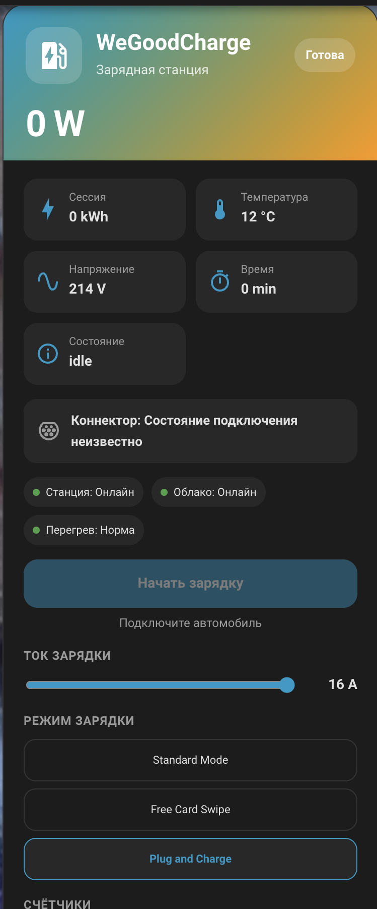

<p align="center">
  
</p>

[Русский](README.md) · [English](README_ENG.md)

# WeGoodCharge для Home Assistant

Нативная community-интеграция для зарядных станций **WeGoodCharge / WGD ICS_10**. Начиная с Home Assistant 2026.11 она устанавливается через встроенный **Marketplace**; на более старых версиях Home Assistant тот же репозиторий можно установить через HACS. Интеграция добавляет устройство Home Assistant, телеметрию, управление зарядкой, выбор тока и режима, счётчики, локальную термозащиту, ночной тариф и собственную Lovelace-карточку.

> [!WARNING]
> Это **неофициальная интеграция**. Используемый MQTT-протокол не является официальным публичным API WeGoodCharge: формат сообщений, команды и состояния были установлены экспериментально по обмену собственной станции WGD ICS_10. На другой модели, аппаратной ревизии или прошивке протокол может отличаться. Перед разрешением команд убедитесь, что ваша станция совместима с `ICS_10 V1.4`.

> [!NOTE]
> Фактическое тестирование интеграции выполнялось на зарядной станции **JIGU 32A 7.6KW GBT** и на данный момент только в **Cloud-режиме**. Local-режим реализован на основе исследованного протокола и архитектуры, но на этой станции пока не проходил полноценную практическую проверку.

## Возможности

- Cloud-режим без перенастройки зарядной станции или роутера;
- полностью локальный режим через MQTT Home Assistant;
- опциональный cloud relay в локальном режиме для сохранения штатного мобильного приложения;
- состояние станции и коннектора, мощность, напряжение, температура, энергия и длительность сессии;
- единое управление Start / Stop;
- установка зарядного тока;
- режимы **Standard Mode**, **Free Card Swipe**, **Plug and Charge**;
- счётчики энергии за сегодня, месяц и всё время;
- локальная защита от перегрева;
- ночная зарядка по тарифному окну;
- собственная карточка WeGoodCharge для дашбордов Home Assistant.

## Архитектура

### Cloud — рекомендуемый режим по умолчанию

```text
Зарядная станция ↔ MQTT производителя ↔ штатное приложение
                          ↕
                  WeGoodCharge integration
                          ↕
                    Home Assistant
```

Интеграция подключается к тому же MQTT-серверу производителя отдельным клиентом, получает ответы станции и сама выполняет периодический опрос. Роутер и станцию менять не нужно. При отсутствии интернета Cloud-режим недоступен.

### Local — автономный режим

```text
Зарядная станция ── перенаправление на OpenWrt ── MQTT Home Assistant
                                                    ↕
                                           WeGoodCharge integration
                                                    ↕
                                              Home Assistant
                                                    ↕ optional relay
                                           MQTT производителя
```

В Local-режиме используется уже настроенная MQTT-интеграция Home Assistant. Второй Mosquitto не нужен. Поскольку штатной настройки адреса MQTT у исследованной WGD ICS_10 нет, трафик станции необходимо перенаправить на локальный брокер средствами роутера. Опциональный cloud relay позволяет одновременно сохранить работу штатного приложения.

> На **JIGU 32A 7.6KW GBT** этот режим пока не тестировался в реальной эксплуатации.

## Установка через Marketplace (Home Assistant 2026.11+)

[](https://my.home-assistant.io/redirect/marketplace_repository/?owner=rgoskolkov&repository=wegood-ha-integration&category=integration)

1. Нажмите кнопку выше либо откройте **Настройки → Marketplace → Add from link**.
2. Если добавляете вручную, укажите `https://github.com/rgoskolkov/wegood-ha-integration` и тип **Integration**.
3. Откройте **WeGoodCharge** в Marketplace и нажмите **Install**.
4. После установки Home Assistant обычно сразу откроет настройку интеграции. Если этого не произошло, откройте **Настройки → Устройства и службы → Добавить интеграцию → WeGoodCharge**.
5. Укажите IMEI станции, способ подключения и параметры MQTT.

Для добавления собственного репозитория Marketplace попросит один раз подключить GitHub через device sign-in. Отдельно устанавливать HACS в Home Assistant 2026.11 и новее не нужно и нельзя.

### Home Assistant 2026.10 и старше

Используйте HACS как раньше: добавьте `rgoskolkov/wegood-ha-integration` как custom repository типа **Integration**, установите **WeGoodCharge**, перезапустите Home Assistant и добавьте интеграцию через **Настройки → Устройства и службы**.

После настройки появится одно устройство **WeGood EV Charger**. Его можно назначить помещению как обычное устройство Home Assistant.

Если раньше использовался старый WeGoodCharge add-on, сначала удалите его в Home Assistant. Нативная интеграция при запуске автоматически очищает его старые retained MQTT Discovery-конфиги `homeassistant/.../wegood_*/config`; рабочие топики станции и MQTT производителя эта очистка не затрагивает.

## Быстрая настройка Cloud

Для Cloud-режима нужны:

- **IMEI / ID станции**;
- адрес MQTT-сервера производителя;
- порт MQTT, обычно `1883` для исследованной станции;
- MQTT username и password;
- отдельный Client ID интеграции. Значение по умолчанию `wegood_ha_gateway_cloud` обычно можно оставить — оно специально отличается от Client ID самой станции;
- протокол `ICS_10 V1.4`, если совместимость вашей станции подтверждена. `Unverified` работает только для чтения.

Топики для исследованной ICS_10 V1.4 строятся из IMEI автоматически, поэтому вручную их обычно задавать не нужно.

### Как получить Cloud MQTT параметры

Если станция использует MQTT без TLS, параметры подключения можно увидеть в трафике **своей станции** в своей локальной сети. Удобнее всего сделать захват на OpenWrt и открыть его в Wireshark.

1. Узнайте локальный IP зарядной станции в OpenWrt.
2. На роутере запустите захват, заменив `192.168.1.50` на IP своей станции:

```sh
tcpdump -i br-lan -nn -s 0 -w /tmp/wegood-mqtt.pcap \
  'host 192.168.1.50 and tcp port 1883'
```

3. Перезапустите Wi-Fi станции или саму станцию, чтобы она создала новое MQTT-соединение.
4. Остановите `tcpdump`, скачайте `/tmp/wegood-mqtt.pcap` и откройте файл в Wireshark.
5. Используйте фильтр `mqtt.msgtype == 1`. Это пакет **MQTT CONNECT**.
6. Внутри CONNECT доступны `Client ID`, `User Name` и `Password`. Адрес назначения TCP-соединения — MQTT host производителя.
7. IMEI виден в MQTT-топиках и сообщениях станции, например в суффиксе `.../<IMEI>`.

Условный пример — значения ниже вымышленные:

```text
Charger IP:        192.168.1.50
MQTT host:         203.0.113.25
MQTT port:         1883
Station IMEI:      A1B2C3D4E5F6
Station Client ID: ESP32_ABC123
Username:          example_user
Password:          example_password
Status topic:      s_w1007_gd/A1B2C3D4E5F6
```

В WeGoodCharge укажите host, port, username, password и IMEI. Для **Client ID интеграции** используйте отдельное значение, например стандартное `wegood_ha_gateway_cloud`, а не Client ID станции.

PCAP-файл содержит учётные данные MQTT и идентификаторы устройства. Не публикуйте его в открытом доступе.

## Настройки

Общие параметры:

- **ID / IMEI станции** — идентификатор зарядной станции;
- **Способ подключения** — `Cloud` или `Local MQTT`;
- **Протокол** — `Unverified / read only` либо `ICS_10 V1.4`;
- **Предельный ток** — 8–32 A;
- **Тайм-аут станции** — 10–86 400 секунд;
- **Опрос телеметрии** — по умолчанию 20 секунд;
- **Опрос настроек** — по умолчанию 120 секунд;
- параметры ночного тарифа.

В Local-режиме задаются топик ответов станции и топик команд. Параметры облачного MQTT нужны там только при включённом cloud relay.

## Карточка WeGoodCharge

Карточка устанавливается вместе с интеграцией. Отдельный frontend-репозиторий, JavaScript resource и YAML не требуются.

<p align="center">
  
</p>

Откройте нужный дашборд → **Редактировать → Добавить карточку → WeGoodCharge**.

Карточка показывает:

- текущее состояние и мощность;
- заметный статус коннектора — подключён автомобиль или нет;
- температуру, напряжение, энергию и время сессии;
- Start / Stop одной кнопкой;
- причину, почему действие временно недоступно;
- ток и режим зарядки;
- состояние связи и термозащиты;
- счётчики энергии и сессий.

## Сущности Home Assistant

Основное управление и телеметрия:

- **Charging** — единый switch Start / Stop;
- **Charging current** — установка тока;
- **Charging mode** — выбор режима;
- **State**, **Connector**, **Power**, **Voltage**, **Temperature**;
- **Session energy**, **Session time**;
- **Observed energy today / this month / total**;
- **Thermal trip**, **Night session**.

Диагностика оставлена только там, где она помогает искать неисправность: **Station online**, **Cloud MQTT**, **Valid frames**, **Relay failures**, **Automatic start inhibited** и число наблюдаемых сессий. Время последнего ответа станции отслеживается только внутри runtime для watchdog и не создаётся как отдельная сущность, чтобы не засорять историю активности устройства.

## Безопасность

Команды Start / Stop / current / mode разрешаются только для подтверждённого `ICS_10 V1.4` и при актуальном состоянии станции. Даже если общий тайм-аут установлен на несколько часов, управляющие команды требуют телеметрию не старше 300 секунд.

Программная термозащита:

```text
> 70 °C → Thermal trip → Stop → повтор Stop до подтверждения остановки
≤ 60 °C → блокировка снимается, автоматический повторный Start не выполняется
```

Эта логика дополняет, а не заменяет штатные защиты EVSE, электрической линии и автомобиля.

Счётчики энергии рассчитываются по наблюдаемой телеметрии и не являются коммерческим прибором учёта.

## Благодарность и материалы

Отдельная благодарность **автору публикаций на DRIVE2**, который исследовал протокол WGD ICS_10 и подробно описал как облачную, так и локальную архитектуру. Эти материалы стали важной отправной точкой для интеграции:

- [Home Assistant gateway и протокол станции](https://www.drive2.ru/l/740263796659981156/)
- [Local MQTT с сохранением облачной ветки](https://www.drive2.ru/l/742549406456222611/)

## Разработка

Откройте корень репозитория в IntelliJ IDEA. Код интеграции находится в `custom_components/wegood_charge`, тесты — в `native_tests`.

Основные проверки:

```sh
python3 -m compileall -q custom_components/wegood_charge
python3 -m unittest discover -s native_tests -v
node --check custom_components/wegood_charge/frontend/wegood-charge-card.js
```
