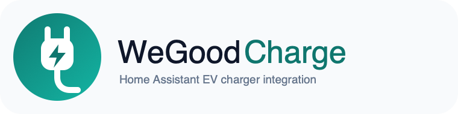
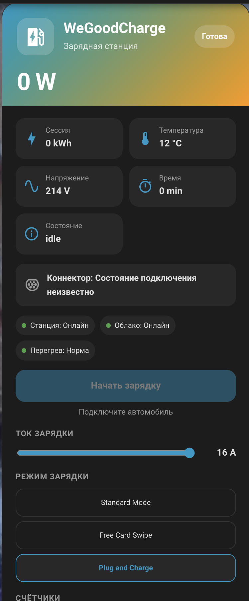

<p align="center">
  
</p>

[Русский](README.md) · [English](README_ENG.md)

# WeGoodCharge for Home Assistant

A native community integration for **WeGoodCharge / WGD ICS_10** EV chargers. Starting with Home Assistant 2026.11, it can be installed through the built-in **Marketplace**. On older Home Assistant releases, the same repository can be installed through HACS.

The integration adds a native Home Assistant device with telemetry, charging controls, current and charging-mode selection, energy counters, local thermal protection, night-tariff automation, and a bundled Lovelace card.

> [!WARNING]
> This is an **unofficial community integration**. The MQTT protocol used by this project is not an official public WeGoodCharge API. Message formats, commands, and states were determined experimentally from traffic generated by a privately owned WGD ICS_10 charger. Other models, hardware revisions, or firmware versions may behave differently. Before enabling control commands, make sure your charger is compatible with the verified `ICS_10 V1.4` protocol profile.

> [!NOTE]
> The integration has been tested on a **JIGU 32A 7.6KW GBT** charger and, so far, only in **Cloud mode**. Local mode is implemented from the observed protocol and architecture, but it has not yet been fully field-tested on this charger.

## Features

- Cloud mode without reconfiguring the charger or router;
- fully local operation through Home Assistant MQTT;
- optional cloud relay in Local mode to preserve the official mobile app;
- charger and connector state, power, voltage, temperature, session energy, and session duration;
- unified Start / Stop control;
- charging-current control;
- **Standard Mode**, **Free Card Swipe**, and **Plug and Charge** modes;
- energy counters for today, current month, and total observed energy;
- local thermal protection;
- night-tariff charging automation;
- bundled WeGoodCharge Lovelace card for Home Assistant dashboards.

## Architecture

### Cloud — recommended default mode

```text
EV charger ↔ Manufacturer MQTT ↔ Official mobile app
                    ↕
           WeGoodCharge integration
                    ↕
              Home Assistant
```

The integration connects to the manufacturer's MQTT broker as a separate client, receives charger responses, and performs its own periodic polling. No router or charger reconfiguration is required. Cloud mode depends on Internet access.

### Local — autonomous mode

```text
EV charger ── traffic redirect on OpenWrt ── Home Assistant MQTT
                                                   ↕
                                          WeGoodCharge integration
                                                   ↕
                                             Home Assistant
                                                   ↕ optional relay
                                          Manufacturer MQTT
```

Local mode uses the MQTT integration already configured in Home Assistant. A second Mosquitto instance is not required.

The tested WGD ICS_10 firmware does not expose a normal setting for changing its MQTT broker address, so charger traffic must be redirected to the local broker by the router. The optional cloud relay can preserve simultaneous access through the manufacturer's mobile app.

> This mode has not yet been field-tested on the **JIGU 32A 7.6KW GBT**.

## Installation through Marketplace (Home Assistant 2026.11+)

[](https://my.home-assistant.io/redirect/marketplace_repository/?owner=rgoskolkov&repository=wegood-ha-integration&category=integration)

1. Click the button above, or open **Settings → Marketplace → Add from link**.
2. If adding the repository manually, enter `https://github.com/rgoskolkov/wegood-ha-integration` and choose **Integration**.
3. Open **WeGoodCharge** in Marketplace and click **Install**.
4. Home Assistant normally opens the integration setup after installation. If it does not, open **Settings → Devices & services → Add integration → WeGoodCharge**.
5. Enter the charger IMEI, connection mode, and MQTT parameters.

When adding a custom Marketplace repository, Home Assistant may ask you to connect GitHub once through device sign-in. HACS is not required on Home Assistant 2026.11 or newer.

### Home Assistant 2026.10 and older

Use HACS: add `rgoskolkov/wegood-ha-integration` as a custom repository of type **Integration**, install **WeGoodCharge**, restart Home Assistant, and add the integration through **Settings → Devices & services**.

After setup, one **WeGood EV Charger** device appears in Home Assistant. It can be assigned to an Area like any other Home Assistant device.

If you previously used the old WeGoodCharge add-on, remove it first. On startup, the native integration automatically clears the old retained MQTT Discovery configs under `homeassistant/.../wegood_*/config`. Charger topics and manufacturer MQTT traffic are not removed.

## Quick Cloud setup

Cloud mode requires:

- charger **IMEI / ID**;
- manufacturer MQTT broker address;
- MQTT port, typically `1883` on the tested charger;
- MQTT username and password;
- a separate Client ID for the integration. The default `wegood_ha_gateway_cloud` is normally fine and intentionally differs from the charger's own Client ID;
- protocol `ICS_10 V1.4` when compatibility has been confirmed. `Unverified` is read-only.

For the tested ICS_10 V1.4 protocol, MQTT topics are generated automatically from the IMEI, so manual topic overrides are usually unnecessary.

### How to obtain Cloud MQTT parameters

If your own charger uses MQTT without TLS, its connection parameters can be observed in traffic inside your own local network. One convenient method is to capture traffic on OpenWrt and inspect it in Wireshark.

1. Find the charger's local IP address in OpenWrt.
2. Start a capture on the router, replacing `192.168.1.50` with your charger's IP:

```sh
tcpdump -i br-lan -nn -s 0 -w /tmp/wegood-mqtt.pcap \
  'host 192.168.1.50 and tcp port 1883'
```

3. Restart the charger's Wi-Fi connection or reboot the charger so it creates a new MQTT connection.
4. Stop `tcpdump`, download `/tmp/wegood-mqtt.pcap`, and open it in Wireshark.
5. Apply the filter `mqtt.msgtype == 1`. This selects **MQTT CONNECT** packets.
6. The CONNECT packet exposes the Client ID, User Name, and Password when TLS is not used. The TCP destination address is the manufacturer's MQTT broker.
7. The charger IMEI is visible in MQTT topics and payloads, usually as the suffix `.../<IMEI>`.

Example with fictional values:

```text
Charger IP:        192.168.1.50
MQTT host:         203.0.113.25
MQTT port:         1883
Station IMEI:      A1B2C3D4E5F6
Station Client ID: ESP32_ABC123
Username:          example_user
Password:          example_password
Status topic:      s_w1007_gd/A1B2C3D4E5F6
```

Enter the host, port, username, password, and IMEI in WeGoodCharge. For the integration's **Client ID**, use a separate value such as the default `wegood_ha_gateway_cloud`, rather than the charger's own Client ID.

A PCAP file may contain MQTT credentials and device identifiers. Do not publish it.

## Configuration

Common settings:

- **Station ID / IMEI** — charger identifier;
- **Connection mode** — `Cloud` or `Local MQTT`;
- **Protocol** — `Unverified / read only` or `ICS_10 V1.4`;
- **Maximum current** — 8–32 A;
- **Station timeout** — 10–86,400 seconds;
- **Telemetry poll interval** — 20 seconds by default;
- **Settings poll interval** — 120 seconds by default;
- night-tariff settings.

Local mode additionally requires the station response and command topics. Manufacturer cloud MQTT settings are only required there when cloud relay is enabled.

## WeGoodCharge card

The card is bundled with the integration. No separate frontend repository, JavaScript resource, or YAML configuration is required.

<p align="center">
  
</p>

Open the desired dashboard → **Edit → Add card → WeGoodCharge**.

The card displays:

- current charger state and power;
- prominent connector state showing whether a vehicle is connected;
- temperature, voltage, session energy, and session duration;
- Start / Stop through one state-aware button;
- the reason why a control action is temporarily unavailable;
- charging current and charging mode;
- connection and thermal-protection state;
- energy and session counters.

The card follows the Home Assistant language automatically. Russian and English are currently included.

## Home Assistant entities

Main controls and telemetry:

- **Charging** — unified Start / Stop switch;
- **Charging current** — current setting;
- **Charging mode** — charging-mode selection;
- **State**, **Connector**, **Power**, **Voltage**, **Temperature**;
- **Session energy**, **Session time**;
- **Observed energy today / this month / total**;
- **Thermal trip**, **Night session**.

Diagnostics are limited to values that are useful for troubleshooting: **Station online**, **Cloud MQTT**, **Valid frames**, **Relay failures**, **Automatic start inhibited**, and the number of observed sessions.

The last charger response timestamp is tracked internally for watchdog and freshness checks, but it is not exposed as a separate entity because frequent timestamp updates would unnecessarily fill the device Activity history.

## Safety

Start / Stop / current / mode commands are enabled only for the verified `ICS_10 V1.4` profile and while charger telemetry is fresh. Even if the general station timeout is configured for several hours, control commands require telemetry no older than 300 seconds.

Software thermal protection:

```text
> 70 °C → Thermal trip → Stop → repeat Stop until charging is confirmed stopped
≤ 60 °C → protection is rearmed; charging does not restart automatically
```

This software layer complements the built-in protection of the EVSE, electrical installation, and vehicle. It does not replace them.

Energy counters are calculated from observed telemetry and are not intended for billing or certified metering.

## Credits and references

Special thanks to the **author of the DRIVE2 articles** who investigated the WGD ICS_10 protocol and documented both the cloud and local architectures. Those publications were an important starting point for this integration:

- [Home Assistant gateway and charger protocol](https://www.drive2.ru/l/740263796659981156/)
- [Local MQTT while preserving the cloud path](https://www.drive2.ru/l/742549406456222611/)

## Development

Open the repository root in IntelliJ IDEA. Integration code is under `custom_components/wegood_charge`; tests are under `native_tests`.

Main checks:

```sh
python3 -m compileall -q custom_components/wegood_charge
python3 -m unittest discover -s native_tests -v
node --check custom_components/wegood_charge/frontend/wegood-charge-card.js
```
